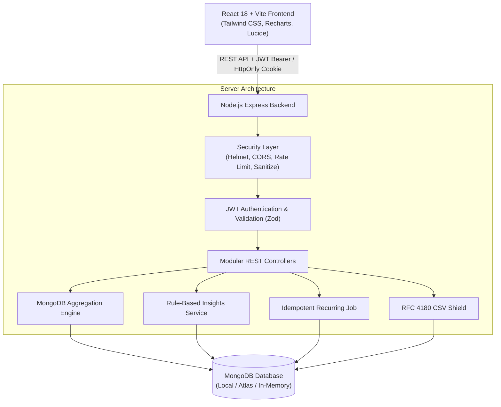
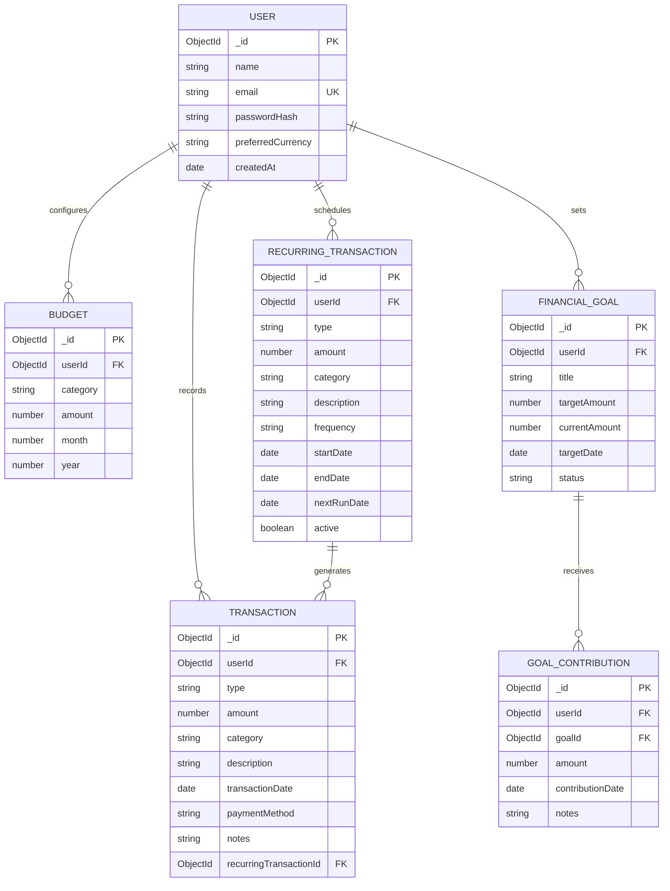

# Smart Expense Tracking and Financial Analysis System Using MongoDB

A complete, production-grade, full-stack web application developed for a final-year **Computer Science and Engineering** academic project. Built with **React (Vite)**, **Node.js/Express**, and **MongoDB (Mongoose)**, this system provides real-time financial tracking, budget allocation, automated recurring schedules, goal tracking, rule-based financial insights, and sanitized audit reporting.

---

## ?? Abstract & Problem Statement

### Problem Statement
Personal financial management is frequently hindered by fragmented spreadsheets, manual calculations, and lack of real-time visibility into spending habits. Traditional static expense trackers lack intelligent categorization, dynamic threshold warnings, and automated recurring accounting, leading to budget overruns, poor savings habits, and vulnerability to formula injection when exporting records.

### Proposed Solution
The **Smart Expense Tracking and Financial Analysis System** leverages a document-oriented MongoDB database to deliver real-time financial telemetry. Every chart, metric card, budget progress bar, smart insight, and export is computed directly from live database aggregations with strict per-user data isolation.

---

## ??? System Architecture



---

## ??? Database Architecture & ER Diagram



---

## ?? Key Implemented Features

1. **Authentication & Identity**:
   - Register, login, logout, profile update, and password modification.
   - Salted Bcrypt password hashing; JWT via Authorization headers and HttpOnly cookies.
   - Duplicate-email prevention and strict cross-user data isolation.

2. **Transaction Management (Full CRUD)**:
   - Record income and expenses with amount, category, date, payment method, description, and notes.
   - Real-time search, multi-field filtering, sorting (date/amount), and pagination.
   - Confirmation dialogs for destructive actions.

3. **Live Financial Dashboard**:
   - Total Income, Total Expenses, Net Cash Flow, Cumulative All-Time Balance, and Savings Rate.
   - Safe zero-income handling (prevents division by zero).
   - Recharts visualizations: Income vs Expenses comparison, Category Breakdown Pie Chart, and 6-Month Cash Flow Trend.
   - Recent transactions feed with dynamic status badges.

4. **Category & Overall Budgeting**:
   - Set monthly budgets per expense category or an overall monthly limit.
   - Compound unique index (`userId, category, month, year`) prevents duplicate rules.
   - Automated 80% limit warning and 100% budget overrun alert callouts.

5. **Financial Goals & Atomic Contributions**:
   - Dedicated savings targets with target dates and status badges.
   - Atomic `$inc` updates on deposits via separate `GoalContribution` collection to avoid double-counting with expense ledgers.

6. **Pluggable Smart Insights Engine**:
   - Rules-based engine evaluating category spending spikes (>20%), dominant categories (>35%), budget overruns, deficit alerts, and discretionary savings recommendations with complete logic breakdown.

7. **Idempotent Recurring Transactions**:
   - Weekly, monthly, and yearly recurring schedules.
   - Idempotent scheduler job with duplicate prevention guaranteeing zero duplicates on repeated runs.

8. **Sanitized CSV & Financial Reports**:
   - Custom statement period summaries with breakdown tables.
   - RFC 4180 CSV export with formula injection protection (neutralizes `=`, `+`, `-`, `@` prefixes).
   - Print-ready statement layout.

---

## ??? Technology Stack

| Layer | Technology |
|---|---|
| **Frontend** | React 18, Vite, Tailwind CSS, React Router DOM v7, Axios, Recharts, Lucide React, React Hook Form |
| **Backend** | Node.js, Express.js, RESTful Architecture, Zod Validation, Dotenv |
| **Security** | Bcrypt.js, JSON Web Tokens (JWT), Helmet, CORS, Express-Rate-Limit, NoSQL Sanitizer |
| **Database** | MongoDB with Mongoose ODM (Compatible with Local MongoDB, Atlas, & In-Memory MongoDB) |
| **Testing** | Vitest, Supertest, React Testing Library, JSDOM |

---

## ? Quick Start & Installation

### 1. Prerequisites
- **Node.js** (v18+ recommended)
- **npm** (v9+)
- *(Optional)* Local MongoDB daemon or MongoDB Atlas connection string. (If local MongoDB is not running, the system will automatically utilize MongoMemoryServer for isolated development and testing).

### 2. Clone & Setup Backend
```bash
cd server
npm install
cp ../.env.example .env
```

Start the backend API:
```bash
npm run dev
# Server runs on http://localhost:5000
```

### 3. Setup Frontend
```bash
cd ../client
npm install
npm run dev
# Frontend runs on http://localhost:5173
```

---

## ?? Automated Testing Suite

The project includes unit and integration tests for both backend and frontend components.

### Run Backend Tests (Vitest + Supertest)
```bash
cd server
npm test
```
**Test Coverage Includes:**
- User registration, duplicate email rejection, bcrypt hashing, and login authentication.
- Strict authorization & cross-user isolation.
- Transaction CRUD, search, filter, and pagination.
- Zero-income savings rate edge cases and metric calculations.
- Compound unique budget constraints and 80%/100% alert thresholds.
- Financial goals atomic `$inc` contributions.
- Recurring scheduler idempotency (zero duplicates on repeated execution).
- CSV formula injection protection.

### Run Frontend Tests (Vitest + React Testing Library)
```bash
cd client
npm test
```
**Test Coverage Includes:**
- Currency, percentage, and date formatters.
- `MetricCard` rendering and trend status styles.
- `InsightCard` rule badge and calculation breakdown display.

---

## ?? Security Architecture

1. **Password Hashing**: Bcrypt with salted rounds; passwords never stored or logged in plain text.
2. **Data Isolation**: Every database query is scoped by `userId` from verified JWT claims.
3. **NoSQL Injection Defense**: Recursive sanitization middleware stripping MongoDB operator keys (`$` and `.`).
4. **CSV Formula Injection Shield**: Cells beginning with `=`, `+`, `-`, or `@` are prepended with `'` to neutralize executable spreadsheet macros.
5. **Rate Limiting**: `express-rate-limit` protects authentication endpoints against brute-force attacks.
6. **HTTP Security Headers**: `helmet` enforces strict content-security and referrer policies.

---

## ?? Deployment Instructions

- **Frontend (Vercel)**: Build directory `client/dist`, build command `npm run build`, set environment variable `VITE_API_URL=https://your-backend.onrender.com/api`.
- **Backend (Render / Railway / AWS)**: Root directory `server`, start command `node src/server.js`, set environment variables `MONGODB_URI`, `JWT_SECRET`, `CLIENT_URL`.
- **Database (MongoDB Atlas)**: Deploy free M0 sandbox cluster and paste connection URI into backend `MONGODB_URI`.

---

## ?? License & Academic Integrity
Developed for academic research and evaluation in Computer Science and Engineering. All business logic, algorithms, aggregation pipelines, and UI layouts are custom implemented.
