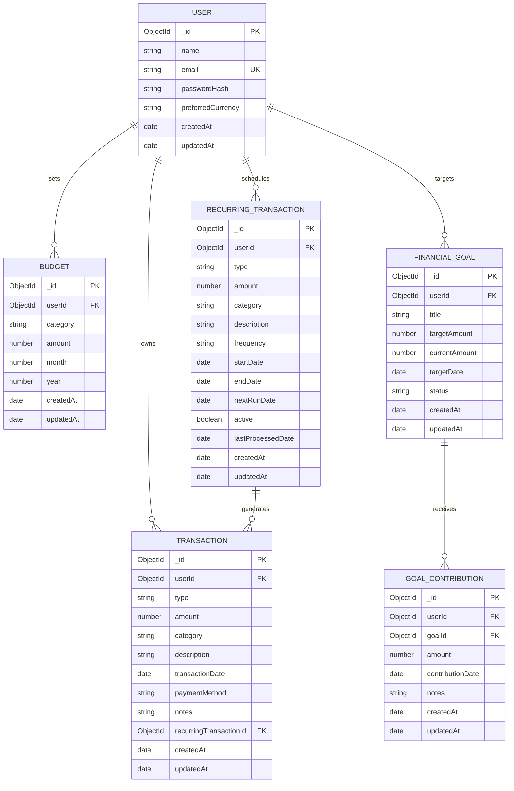

# Database Schema Documentation

## Database System
- **Engine**: MongoDB (Document-Oriented NoSQL Database)
- **ODM**: Mongoose v8.x for Node.js
- **Connection URI**: `mongodb://127.0.0.1:27017/smart_expense_tracker` or MongoDB Atlas Cluster

---

## Entity-Relationship Architecture

---

## Detailed Collections Specification

### 1. `users` Collection
Stores registered user accounts and authentication credentials.

| Field | Type | Required | Unique | Default | Description |
|---|---|---|---|---|---|
| `_id` | ObjectId | Yes | Yes | Auto | Primary key |
| `name` | String | Yes | No | - | Full name (2-50 chars) |
| `email` | String | Yes | Yes | - | Normalized lowercased email |
| `passwordHash` | String | Yes | No | - | Bcrypt hashed password (hidden by default) |
| `preferredCurrency` | String | No | No | 'USD' | Currency code (USD, EUR, GBP, INR, CAD, AUD, JPY) |
| `createdAt` | Date | Auto | No | Date.now | Timestamp |
| `updatedAt` | Date | Auto | No | Date.now | Timestamp |

---

### 2. `transactions` Collection
Core ledger recording individual income and expense items.

| Field | Type | Required | Index | Description |
|---|---|---|---|---|
| `_id` | ObjectId | Yes | PK | Primary key |
| `userId` | ObjectId (FK) | Yes | Yes | Reference to `users._id` |
| `type` | String ('income', 'expense') | Yes | Yes | Transaction classification |
| `amount` | Number | Yes | No | Positive numeric value |
| `category` | String | Yes | Yes | Expense or Income category |
| `description` | String | Yes | No | Max 200 chars description |
| `transactionDate` | Date | Yes | Yes | Transaction timestamp (default: now) |
| `paymentMethod` | String | No | No | Cash, Card, UPI, Bank Transfer, etc. |
| `notes` | String | No | No | Optional additional memo |
| `recurringTransactionId`| ObjectId (FK) | No | No | Ref to source recurring rule if automated |

#### Indexes:
1. `{ userId: 1, transactionDate: -1 }` — High-efficiency chronological listing and date range queries.
2. `{ userId: 1, category: 1, transactionDate: 1 }` — Accelerated category aggregation pipelines.
3. `{ userId: 1, type: 1 }` — Fast separation of income vs expense records.

---

### 3. `budgets` Collection
Stores monthly expenditure ceiling rules per category or overall.

| Field | Type | Required | Description |
|---|---|---|---|
| `_id` | ObjectId | Yes | Primary key |
| `userId` | ObjectId (FK) | Yes | Reference to `users._id` |
| `category` | String | No (null for Overall) | Expense category name or null for overall limit |
| `amount` | Number | Yes | Positive monthly spending limit |
| `month` | Number | Yes | 1 to 12 (calendar month) |
| `year` | Number | Yes | 2000 to 2100 |

#### Compound Unique Index:
`{ userId: 1, category: 1, month: 1, year: 1 }` (unique: true)
- Enforces database-level uniqueness preventing duplicate budget allocations for the same user, category, and month.

---

### 4. `financialgoals` Collection
Tracks targeted savings buckets.

| Field | Type | Required | Description |
|---|---|---|---|
| `_id` | ObjectId | Yes | Primary key |
| `userId` | ObjectId (FK) | Yes | Reference to `users._id` |
| `title` | String | Yes | Goal title (e.g. Emergency Fund) |
| `targetAmount` | Number | Yes | Target accumulation amount |
| `currentAmount`| Number | No (default: 0) | Accumulated savings |
| `targetDate` | Date | No | Expected completion deadline |
| `status` | String | No | 'in_progress', 'completed', 'cancelled' |

---

### 5. `goalcontributions` Collection
Atomic deposit history records for financial goals.

| Field | Type | Required | Description |
|---|---|---|---|
| `_id` | ObjectId | Yes | Primary key |
| `userId` | ObjectId (FK) | Yes | Reference to `users._id` |
| `goalId` | ObjectId (FK) | Yes | Reference to `financialgoals._id` |
| `amount` | Number | Yes | Contribution deposit amount |
| `contributionDate` | Date | Yes | Deposit timestamp |
| `notes` | String | No | Memo / transfer reference |

---

### 6. `recurringtransactions` Collection
Automated recurring transaction templates.

| Field | Type | Required | Description |
|---|---|---|---|
| `_id` | ObjectId | Yes | Primary key |
| `userId` | ObjectId (FK) | Yes | Reference to `users._id` |
| `type` | String | Yes | 'income' or 'expense' |
| `amount` | Number | Yes | Transaction amount |
| `category` | String | Yes | Valid category |
| `description` | String | Yes | Recurring rule name |
| `frequency` | String | Yes | 'weekly', 'monthly', 'yearly' |
| `startDate` | Date | Yes | Effective starting date |
| `endDate` | Date | No | Optional termination date |
| `nextRunDate` | Date | Yes | Next scheduled execution date |
| `active` | Boolean | No (default: true) | Active/Paused state |
| `lastProcessedDate` | Date | No | Timestamp of latest run |
